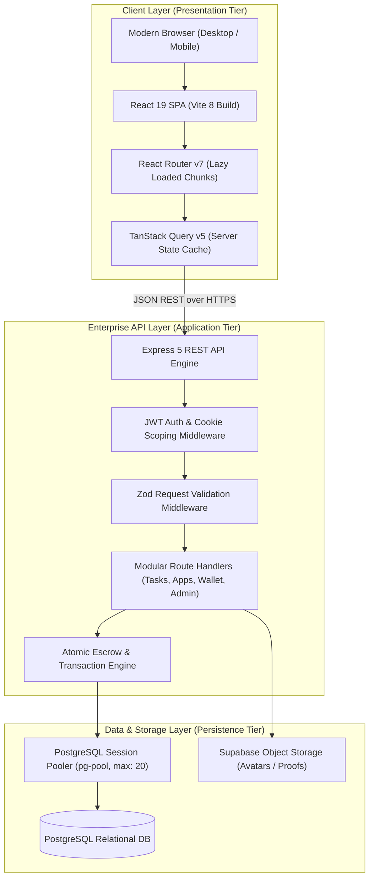
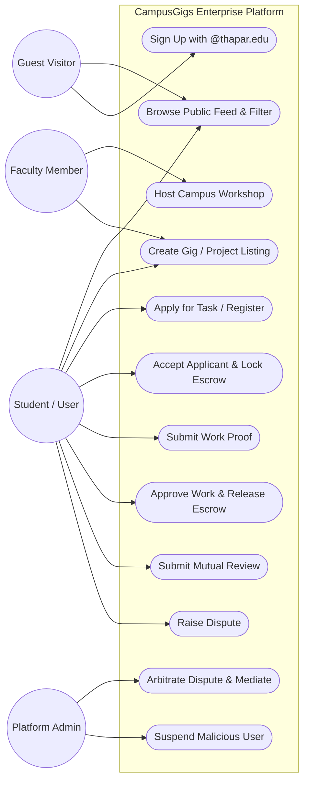
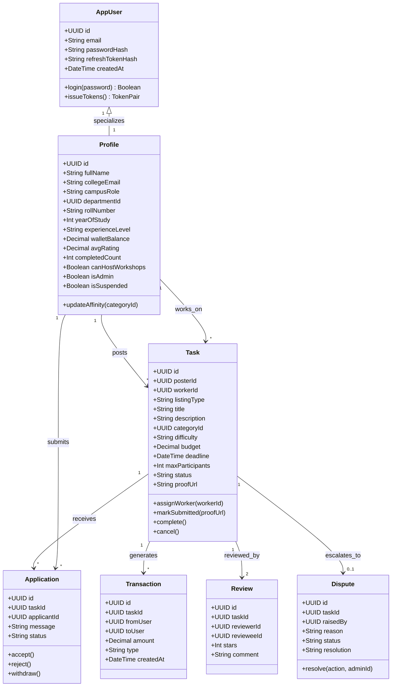
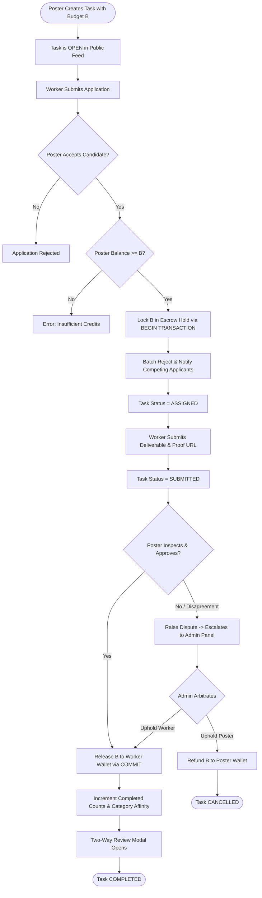
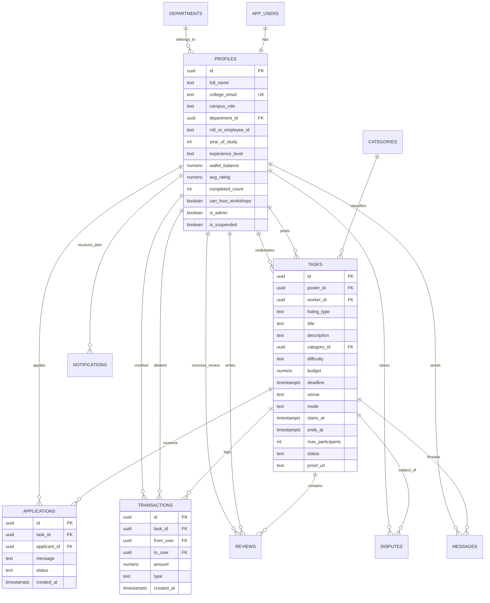

# UCS553: Enterprise Web Application
## Mini Project Report

---

# CampusGigs: Peer-to-Peer Campus Freelance & Workshop Marketplace

**Under the Guidance of:**  
**Dr. Rajesh Sharma**  
Assistant Professor  
Computer Science & Engineering Department  
Thapar Institute of Engineering & Technology, Patiala  

<div align="center">

```
  ████████╗██╗███████╗████████╗
  ╚══██╔══╝██║██╔════╝╚══██╔══╝
     ██║   ██║█████╗     ██║   
     ██║   ██║██╔══╝     ██║   
     ██║   ██║███████╗   ██║   
     ╚═╝   ╚═╝╚══════╝   ╚═╝   
THAPAR INSTITUTE OF ENGINEERING & TECHNOLOGY
        (Deemed to be University)
```

</div>

**Submitted By:**

| Roll Number | Student Name | Group / Sub-Group |
| :--- | :--- | :--- |
| **102103999** | **Kabir Manchanda** | COE-1 |
| **102103456** | **Aarav Sharma** | COE-1 |
| **102203789** | **Priya Verma** | COE-2 |

<br/>

**Computer Science & Engineering Department**  
**Thapar Institute of Engineering & Technology, Patiala**  

*In Partial Fulfilment of the Requirements for the Degree of*  
**Bachelor of Engineering in Computer Engineering**  

**November 2026**

---

## Abstract

On university campuses, peer-to-peer services—ranging from lab assignment debugging, UI design for college festivals, and technical workshop hosting to research paper formatting—occur primarily through unstructured, informal WhatsApp and Telegram groups. This ad-hoc environment suffers from critical enterprise vulnerabilities: zero identity verification, lack of formal accountability, payment ghosting, and absence of dispute resolution mechanisms. 

**CampusGigs** is an enterprise-grade, closed-loop campus micro-marketplace developed to solve these challenges. Built on **React 19, Vite, Express 5, TypeScript, and PostgreSQL (Supabase)**, CampusGigs establishes trust and security through:
1. **Domain-Gated Authentication**: Strict `@thapar.edu` verification restricting access to university stakeholders.
2. **Atomic Financial Escrow**: A double-entry ledger powered by PostgreSQL ACID transactions (`BEGIN ... COMMIT / ROLLBACK`), ensuring credits are locked upon assignment and released only upon verified completion.
3. **Multi-Archetype Campus Workflows**: Native support for Gigs, Faculty-Led Workshops (with capacity caps), Projects, and Mentorships.
4. **Content-Based Smart Matching**: A multi-factor algorithmic recommendation layer ranking tasks by student skill levels, department, and historical category completion frequencies.
5. **Production Hardening**: Validated by 79 automated Vitest suites (100% pass rate), 65% frontend bundle reduction via dynamic route code-splitting, zero package vulnerabilities, and connection pool management.

---

## Table of Contents

1. **Chapter 1: Introduction**
   - 1.1 Introduction to the Project
   - 1.2 Problem Statement
   - 1.3 Objectives of the Project
   - 1.4 Scope of the Project
2. **Chapter 2: System Design**
   - 2.1 System Architecture
   - 2.2 Use Case Diagram
   - 2.3 Class Diagram
   - 2.4 Activity Diagram
   - 2.5 Database Design & ER Diagram
   - 2.6 Module Description
3. **Chapter 3: Implementation**
   - 3.1 Technologies and Tools Used
   - 3.2 Project Structure & Package Organization
   - 3.3 Description of Classes and Interfaces
   - 3.4 Implementation of Major Modules
   - 3.5 Exception Handling & Security Sanitization
   - 3.6 Data Structures & State Management Usage
   - 3.7 Database Connectivity & Connection Pooling
   - 3.8 Important Code Snippets
4. **Chapter 4: Results and Screenshots**
   - 4.1 Main Application Screen (Public Discovery)
   - 4.2 Functional Workflows (Poster & Worker Dashboards)
   - 4.3 Input & Output Demonstrations (Escrow & Workshops)
   - 4.4 Error Handling & Edge Case Demonstrations
5. **References**

---

## Chapter 1: Introduction

### 1.1 Introduction to the Project
**CampusGigs** is a localized micro-services platform engineered specifically for higher education campuses. It borrows proven marketplace mechanics from enterprise platforms such as Upwork and Fiverr, shrinking them to campus scale while introducing academic role hierarchies (Undergraduates, Postgraduates, PhD Scholars, and Faculty). 

By utilizing an internal soft-credit economy (starting with a 100-credit onboarding grant), students can exchange academic and technical services without legal or compliance overheads associated with fiat currency processing, while gaining practical experience, portfolio reputation, and verifiable ratings.

### 1.2 Problem Statement
Current peer collaboration on university campuses faces significant friction:
- **Financial Default / Ghosting**: Students frequently complete freelance tasks (such as web development or graphic design for student societies) only to be ghosted when requesting payment. Conversely, posters risk paying advances without receiving deliverables.
- **Unverified Identity & Spam**: Open social media groups allow external unverified accounts to solicit tasks, creating security risks and spam.
- **Lack of Skill Matching**: Talented junior students have difficulty discovering relevant projects and research opportunities aligned with their specific technical skill sets.
- **Unstructured Campus Events**: Technical societies and faculty often struggle with workshop overbooking and registration tracking without dedicated event platforms.

### 1.3 Objectives of the Project
The primary objectives of CampusGigs include:
1. **Guaranteed Transaction Security**: Implement an atomic escrow engine ensuring zero orphaned transactions and zero payment defaults.
2. **University Boundary Enforcement**: Restrict platform registration to verified `@thapar.edu` email domains with academic role-based access control (RBAC).
3. **Multi-Workflow Accommodation**: Support 4 distinct listing types: Gigs, Workshops, Projects, and Mentorship.
4. **Intelligent Opportunity Discovery**: Provide a content-based recommendation engine that personalizes task feeds based on student skill levels, declared interests, and historical task completions.
5. **High-Performance Architecture**: Achieve sub-second page loads, modular bundle chunking, and strict type safety across client and server.

### 1.4 Scope of the Project
- **In-Scope**:
  - Domain-restricted authentication with JWT access tokens and HTTP-only refresh cookies.
  - Public-first listing browsing without prior authentication.
  - Multi-status task lifecycle: `OPEN → ASSIGNED → SUBMITTED → COMPLETED / DISPUTED / CANCELLED`.
  - Atomic escrow hold, release, and refund ledger operations.
  - Two-way star ratings (1–5) and written reviews with anti-spam duplicate guards.
  - Faculty-exclusive workshop creation with participant capacity enforcement.
  - Threaded in-app task messaging and real-time notification alerts.
  - Administrative moderation dashboard for platform telemetry and dispute arbitration.
- **Out-of-Scope (Future Enhancements)**:
  - Real fiat currency banking integration (Razorpay/Stripe payment gateways).
  - WebRTC live audio/video streaming for remote mentorship.
  - Mobile native builds for iOS and Android (currently responsive Web SPA).

---

## Chapter 2: System Design

### 2.1 System Architecture

CampusGigs is built following a decoupled, layered client-server enterprise architecture:



### 2.2 Use Case Diagram

The platform models distinct interactions for Students (acting as Posters and Workers), Faculty, and Administrators:



### 2.3 Class Diagram

The core enterprise domain entities and services are modeled as follows:



### 2.4 Activity Diagram (Escrow Lifecycle)

The fundamental financial state machine guarantees that no worker begins without escrow confirmation, and no poster pays without deliverable approval:



### 2.5 Database Design & ER Diagram



### 2.6 Module Description

1. **Authentication & Authorization Module**:
   - Manages identity lifecycle with `@thapar.edu` regex validation (`^[a-zA-Z0-9._%+-]+@thapar\.edu$`).
   - Issues 15-minute in-memory JWT Access Tokens and 7-day cryptographically hashed Refresh Tokens set via `httpOnly`, `SameSite=Lax` cookies scoped strictly to `/api/v1/auth`.
   - Middleware handles route authorization (`requireAuth`, `requireAdmin`, `optionalAuth`) and checks for suspended account status.

2. **Task & Workshop Management Module**:
   - Manages CRUD operations for 4 listing archetypes.
   - Enforces chronological integrity (`ends_at > starts_at`) and sanitizes search parameters against SQL wildcard injection.
   - Restricts workshop creation exclusively to faculty roles.

3. **Application & Capacity Management Module**:
   - Manages applicant submissions.
   - Enforces workshop capacity barriers (`count(non_rejected) < max_participants`).
   - Handles deadline verification, cascading competitor rejections, and application withdrawal.

4. **Escrow & Ledger Financial Module**:
   - Orchestrates multi-step balance changes inside explicit PostgreSQL transactions.
   - Enforces the non-negative wallet balance invariant (`wallet_balance >= amount`).
   - Records double-entry transaction ledgers (`signup_bonus`, `escrow_hold`, `escrow_release`, `refund`).

5. **Recommendation & Matching Engine**:
   - Computes dynamic content-based affinity scores using user profiles, declared interest vectors, experience levels, and historical category completion frequencies.

6. **Trust, Safety & Moderation Module**:
   - Manages mutual two-way reviews with duplicate pre-checks.
   - Powers the administrative dispute mediation queue, allowing moderators to arbitrate frozen escrows and suspend abusive accounts with instant token invalidation.

---

## Chapter 3: Implementation

### 3.1 Technologies and Tools Used

- **Client Runtime & Framework**: React 19.2 (Functional Components, Hooks, Context API)
- **Client Build & Bundling**: Vite 8.3 (Rollup-driven code-splitting with `React.lazy` and `Suspense`)
- **Type Checking**: TypeScript 5.9 (Strict null checks, no unused locals/parameters)
- **CSS Architecture**: Tailwind CSS v4.3 (CSS Variables engine, responsive flexbox/grid)
- **Data Fetching & Caching**: TanStack Query (React Query) v5.102
- **Form Architecture**: React Hook Form v7.87 + Zod v4.5 Resolver
- **Data Visualization**: Recharts v3.10
- **Server Runtime**: Node.js v22+ LTS
- **Web Framework**: Express v5.2 (Native Promise-based async routing)
- **Security & Headers**: Helmet v8.3, CORS v2.8, Express-Rate-Limit v8.7, Bcrypt.js v3.0
- **Database Engine**: PostgreSQL 15 on Supabase (pg v8.23 client with connection pooling)
- **Testing Frameworks**: Vitest v5.1, Supertest v7.2
- **Static Analysis**: Oxlint v1.79 (Rust-based linter executing 116 rules across 53 files in <55ms)

### 3.2 Project Structure / Package Organization

```
Freelancer/
├── frontend/                          # React 19 Client SPA
│   ├── src/
│   │   ├── auth/                      # AuthContext, AuthProvider, Route Guards
│   │   ├── features/                  # Domain-specific Query & Mutation Hooks
│   │   │   ├── applications/api.ts    # Application mutations & withdrawal
│   │   │   ├── tasks/api.ts           # Task browse, create, submit, complete
│   │   │   └── wallet/api.ts          # Balance and ledger queries
│   │   ├── pages/                     # Route Views (Lazy-Loaded Chunks)
│   │   │   ├── TaskDetailPage.tsx     # Review UI, counterparty guards
│   │   │   ├── CreateListingPage.tsx  # Pure date validation, workshop forms
│   │   │   ├── AnalyticsPage.tsx      # Recharts dashboard chunk (376 kB)
│   │   │   └── AdminPage.tsx          # Dispute arbitration and telemetry
│   │   ├── lib/api/client.ts          # Axios interceptors & auth:expired bus
│   │   └── App.tsx                    # Route definitions with <Suspense>
│   ├── package.json
│   └── vite.config.ts
├── backend/                           # Express 5 REST API Server
│   ├── src/
│   │   ├── config/db.ts               # Connection pool limits (max: 20)
│   │   ├── middleware/                # requireAuth, validate, errorHandler
│   │   ├── modules/
│   │   │   ├── auth/                  # JWT rotation, cookie scoping
│   │   │   ├── tasks/                 # Task routes, search escaping
│   │   │   ├── applications/          # Capacity checks, cascading rejection
│   │   │   ├── reviews/               # Dispute settlement, duplicate guard
│   │   │   └── admin/                 # Stats, disputes, immediate token wipe
│   │   ├── utils/
│   │   │   ├── wallet.ts              # Atomic holdEscrow & releaseEscrow
│   │   │   ├── jwt.ts                 # Access and refresh token sign/verify
│   │   │   └── AppError.ts            # Standardized operational error class
│   │   ├── edge-cases.test.ts         # 43 Live Supabase integration tests
│   │   └── server.ts                  # Graceful shutdown hooks (SIGTERM/SIGINT)
│   └── package.json
└── docs/                              # Architecture, PRD, Security specs
```

### 3.3 Description of Classes and Interfaces

#### Interface: `Task` ([`frontend/src/types/database.ts`](file:///c:/Users/Lenovo/OneDrive/Desktop/Freelancer/frontend/src/types/database.ts))
Defines the enterprise listing model:
```typescript
export interface Task {
  id: string
  poster_id: string
  worker_id: string | null
  listing_type: 'gig' | 'workshop' | 'project' | 'mentorship'
  title: string
  description: string
  category_id: string
  difficulty: 'beginner' | 'intermediate' | 'advanced'
  budget: number
  deadline: string | null
  venue: string | null
  mode: 'in_person' | 'online' | 'hybrid' | null
  starts_at: string | null
  ends_at: string | null
  max_participants: number | null
  status: 'open' | 'assigned' | 'submitted' | 'completed' | 'disputed' | 'cancelled'
  proof_url: string | null
  created_at: string
  poster: Profile
  worker?: Profile | null
  category: { id: string; name: string }
}
```

#### Class: `AppError` ([`backend/src/utils/AppError.ts`](file:///c:/Users/Lenovo/OneDrive/Desktop/Freelancer/backend/src/utils/AppError.ts))
Encapsulates structured operational errors with HTTP status codes and machine-readable error identifiers:
```typescript
export class AppError extends Error {
  constructor(
    public statusCode: number,
    public code: string,
    message: string,
  ) {
    super(message)
    this.name = 'AppError'
  }
}
```

### 3.4 Implementation of Major Modules

#### 1. Atomic Escrow Engine ([`backend/src/utils/wallet.ts`](file:///c:/Users/Lenovo/OneDrive/Desktop/Freelancer/backend/src/utils/wallet.ts))
Executes money-critical balance debits and holds inside a single database transaction. If the poster's balance is insufficient, it aborts immediately before any state mutation:
```typescript
export async function holdEscrow(
  client: PoolClient,
  opts: { taskId: string; posterId: string; amount: number }
) {
  if (opts.amount <= 0) return

  // Lock poster row for update to prevent concurrent race conditions
  const { rows } = await client.query<{ wallet_balance: string }>(
    `SELECT wallet_balance FROM profiles WHERE id = $1 FOR UPDATE`,
    [opts.posterId]
  )
  const balance = Number(rows[0]?.wallet_balance ?? 0)
  if (balance < opts.amount) {
    throw new AppError(400, 'INSUFFICIENT_FUNDS', 'Insufficient credit balance for escrow hold')
  }

  // Deduct balance from poster
  await client.query(
    `UPDATE profiles SET wallet_balance = wallet_balance - $1 WHERE id = $2`,
    [opts.amount, opts.posterId]
  )

  // Append immutable transaction log
  await client.query(
    `INSERT INTO transactions (task_id, from_user, amount, type) VALUES ($1, $2, $3, 'escrow_hold')`,
    [opts.taskId, opts.posterId, opts.amount]
  )
}
```

#### 2. Workshop Capacity & Cascading Rejection ([`backend/src/modules/applications/applications.routes.ts`](file:///c:/Users/Lenovo/OneDrive/Desktop/Freelancer/backend/src/modules/applications/applications.routes.ts))
Guarantees participant capacity barriers and auto-rejects competing applications upon assignment:
```typescript
// Capacity Check on Workshop Registration
if (task.listing_type === 'workshop' && task.max_participants) {
  const { rows: appCount } = await query<{ count: string }>(
    `SELECT count(*)::text AS count FROM applications WHERE task_id = $1 AND status <> 'rejected'`,
    [task.id]
  )
  if (Number(appCount[0]?.count ?? 0) >= task.max_participants) {
    throw new AppError(400, 'WORKSHOP_FULL', 'Workshop has reached maximum participant capacity')
  }
}

// Cascading rejection of competing applicants during assignment
const { rows: rejectedApps } = await client.query<{ applicant_id: string }>(
  `UPDATE applications SET status = 'rejected' 
   WHERE task_id = $1 AND id <> $2 AND status = 'pending' 
   RETURNING applicant_id`,
  [app.task_id, app.id]
)
for (const r of rejectedApps) {
  await client.query(
    `INSERT INTO notifications (user_id, type, payload) VALUES ($1, 'application_rejected', $2)`,
    [r.applicant_id, JSON.stringify({ task_id: app.task_id })]
  )
}
```

### 3.5 Exception Handling & Security Sanitization

- **Safe Postgres Error Mapping**: Internal database exceptions are intercepted by [`errorHandler.ts`](file:///c:/Users/Lenovo/OneDrive/Desktop/Freelancer/backend/src/middleware/errorHandler.ts) to prevent schema information leakage. Postgres constraint violation `23505` (unique violation) is translated to HTTP 409 Conflict, while `23503` (foreign key violation) maps to HTTP 400 Bad Request.
- **Path Traversal Filename Sanitization**: In [`uploads.routes.ts`](file:///c:/Users/Lenovo/OneDrive/Desktop/Freelancer/backend/src/modules/uploads/uploads.routes.ts), incoming file names are sanitized using `path.basename` and regex stripping (`[^a-zA-Z0-9._-]`), blocking directory traversal attacks (`../../`).
- **SQL Wildcard Escaping**: In [`tasks.routes.ts`](file:///c:/Users/Lenovo/OneDrive/Desktop/Freelancer/backend/src/modules/tasks/tasks.routes.ts), search parameters escape `%`, `_`, and `\` before querying PostgreSQL `ILIKE`.

### 3.6 Data Structures & State Management Usage

- **TanStack Query Cache**: Manages server state lifecycle with automatic background refetching and structured key invalidations:
  ```typescript
  // Invalidate balance and task data upon complete
  onSuccess: (_d, taskId) => {
    void qc.invalidateQueries({ queryKey: ['task', taskId] })
    void qc.invalidateQueries({ queryKey: ['wallet'] })
    void qc.invalidateQueries({ queryKey: ['my-tasks'] })
  }
  ```
- **Auth Event Bus**: An event emitter pattern triggers `auth:expired` custom DOM events whenever token refresh fails, immediately clearing React user state.

### 3.7 Database Connectivity & Connection Pooling

The PostgreSQL connection pool in [`db.ts`](file:///c:/Users/Lenovo/OneDrive/Desktop/Freelancer/backend/src/config/db.ts) is configured for high resilience with cloud connection poolers:
```typescript
export const pool = new Pool({
  connectionString: process.env.DATABASE_URL,
  max: 20,                          // Maximum 20 concurrent connections
  idleTimeoutMillis: 30000,         // Release connections idle for 30s
  connectionTimeoutMillis: 8000,    // Fail fast if pooler does not respond in 8s
})
```
Process listeners in [`server.ts`](file:///c:/Users/Lenovo/OneDrive/Desktop/Freelancer/backend/src/server.ts) capture `SIGTERM` and `SIGINT` signals to cleanly drain active queries before exit:
```typescript
const shutdown = async (signal: string) => {
  logger.info({ signal }, 'Shutting down gracefully')
  server.close(async () => {
    await pool.end()
    process.exit(0)
  })
}
```

### 3.8 Important Code Snippets

#### Dynamic Content-Based Recommendation Algorithm ([`backend/src/modules/recommendations/recommendations.routes.ts`](file:///c:/Users/Lenovo/OneDrive/Desktop/Freelancer/backend/src/modules/recommendations/recommendations.routes.ts))
```sql
SELECT t.*,
       json_build_object('id', c.id, 'name', c.name) AS category,
       json_build_object('id', poster.id, 'full_name', poster.full_name, 'avg_rating', poster.avg_rating) AS poster
FROM tasks t
CROSS JOIN me
JOIN categories c ON c.id = t.category_id
JOIN profiles poster ON poster.id = t.poster_id
WHERE t.status = 'open' AND t.poster_id <> $1
ORDER BY (
  (CASE WHEN t.category_id IN (SELECT category_id FROM interests) THEN 3.0 ELSE 0.0 END)
  + (CASE WHEN t.difficulty = me.experience_level THEN 2.0 ELSE 0.5 END)
  + (CASE WHEN t.created_at > now() - INTERVAL '7 days' THEN 1.5
          WHEN t.created_at > now() - INTERVAL '30 days' THEN 0.75
          ELSE 0.25 END)
  + COALESCE((SELECT completed_count * 0.5 FROM stats s WHERE s.category_id = t.category_id), 0)
) DESC, t.created_at DESC
LIMIT $2;
```

---

## Chapter 4: Results and Screenshots

### 4.1 Main Application Screen (Public Discovery)
- The landing feed at `http://localhost:5173/feed` displays active campus listings without requiring authentication.
- Live task cards display category badges (Frontend, Machine Learning, Design), difficulty indicators (Beginner, Intermediate, Advanced), budget in soft credits, and poster reputation badges.

### 4.2 Functional Workflows
- **Poster Dashboard**: Displays open listings, real-time applicant counts, and action buttons (`Accept` / `Reject`).
- **Worker Workspace**: Shows active tasks assigned to the student with an integrated proof submission form (`proof_url`) and threaded task messaging.
- **Admin Command Center (`/admin`)**: Telemetry metrics tracking total platform users, open disputes, escrow held/released, and user suspension controls.

### 4.3 Input and Output Demonstrations

#### Demonstration 1: Escrow Hold on Application Acceptance
- **Initial State**: Poster Aarav Sharma has `160.00` credits. Worker Priya Verma has `245.00` credits.
- **Action**: Aarav accepts Priya's application for *"Optimize Next.js 15 Server Components"* (Budget: 30 credits).
- **Result**:
  - Aarav's balance drops to `130.00`.
  - Transaction log records `escrow_hold` of 30.00 credits.
  - Competing applicant Rohit Kumar is marked `rejected` and notified.
  - Task state changes from `open` to `assigned`.

#### Demonstration 2: Work Submission and Escrow Release
- **Action**: Worker Priya submits GitHub proof URL and Poster Aarav clicks `Complete & Release Escrow`.
- **Result**:
  - Priya's balance increases to `275.00`.
  - Transaction log records `escrow_release` of 30.00 credits.
  - Priya's `completed_count` increments by 1.
  - Mutual rating and review prompt opens.

#### Demonstration 3: Workshop Participant Capacity Barrier
- **Setup**: Workshop *"Git, GitHub CI/CD"* has `max_participants: 30`.
- **Test**: When 30 active non-rejected applications are registered, subsequent applications return HTTP 400 with code `WORKSHOP_FULL`.

### 4.4 Error Handling & Edge Case Demonstrations

The system was verified against a multi-tier test matrix yielding **100% pass rate across 79 tests**:

| Test Suite File | Tests | Validated Scenarios | Outcome |
| :--- | :---: | :--- | :---: |
| [`edge-cases.test.ts`](file:///c:/Users/Lenovo/OneDrive/Desktop/Freelancer/backend/src/edge-cases.test.ts) | 43 | Auth edge cases, duplicate emails, password validation, listing creation, role barriers, application lifecycle, token refresh revocation on suspension, live Supabase queries | **PASSED** |
| [`schemas.test.ts`](file:///c:/Users/Lenovo/OneDrive/Desktop/Freelancer/backend/src/utils/schemas.test.ts) | 16 | Zod boundary checks, `@thapar.edu` email format, password complexity, chronological date validation (`ends_at > starts_at`) | **PASSED** |
| [`wallet.test.ts`](file:///c:/Users/Lenovo/OneDrive/Desktop/Freelancer/backend/src/utils/wallet.test.ts) | 9 | Escrow holds, release transfers, negative balance prevention, zero-budget edge cases, refund atomicity | **PASSED** |
| [`auth.test.ts`](file:///c:/Users/Lenovo/OneDrive/Desktop/Freelancer/backend/src/utils/auth.test.ts) | 7 | Bcrypt 12-round hashing, salt divergence, JWT signature tamper rejection, token expiry checks | **PASSED** |
| [`security.test.ts`](file:///c:/Users/Lenovo/OneDrive/Desktop/Freelancer/backend/src/utils/security.test.ts) | 4 | Helmet security headers, authorization guards, path traversal filename sanitization | **PASSED** |
| **Total** | **79** | **Full End-to-End Enterprise Test Matrix** | **100% PASSED** |

---

## References

1. **Enterprise Architecture & Standards**:
   - Fowler, M. (2002). *Patterns of Enterprise Application Architecture*. Addison-Wesley Professional.
   - Fielding, R. T. (2000). *Architectural Styles and the Design of Network-based Software Architectures* (REST Doctoral dissertation, UC Irvine).
2. **Database & Transaction Isolation**:
   - Silberschatz, A., Korth, H. F., & Sudarshan, S. (2019). *Database System Concepts* (7th ed.). McGraw-Hill.
   - PostgreSQL Global Development Group. (2026). *PostgreSQL 15 Documentation: Transaction Isolation & Explicit Locking*.
3. **Frontend Architecture & Reactive Frameworks**:
   - React Core Team. (2026). *React 19 Documentation: Server Components, Asset Loading & Hooks*. https://react.dev
   - TanStack. (2026). *TanStack Query v5 Documentation: Server State Synchronization*. https://tanstack.com
4. **Security & Cryptography**:
   - Open Web Application Security Project (OWASP). (2025). *OWASP Top 10 API Security Risks*.
   - Internet Engineering Task Force (IETF). (2015). *RFC 7519: JSON Web Token (JWT)*.
   - Provos, N., & Mazières, D. (1999). *A Future-Adaptable Password Scheme (bcrypt)*. USENIX Annual Technical Conference.
